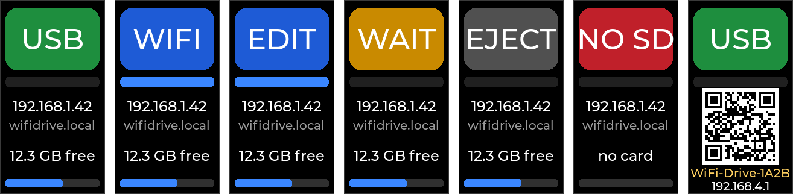
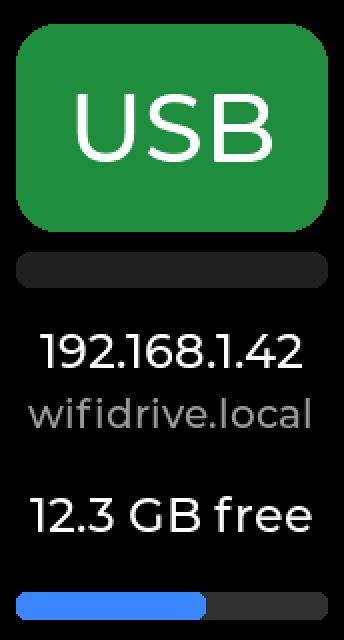
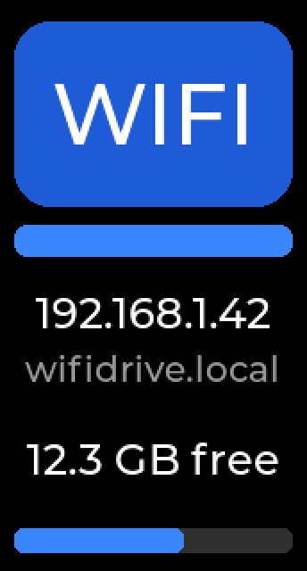
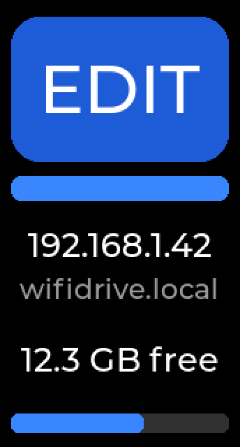
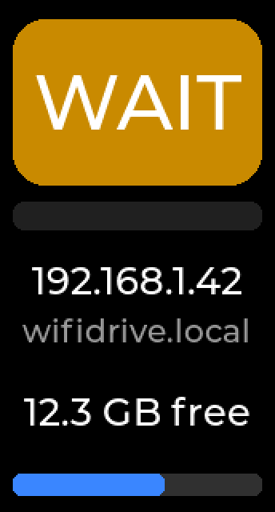
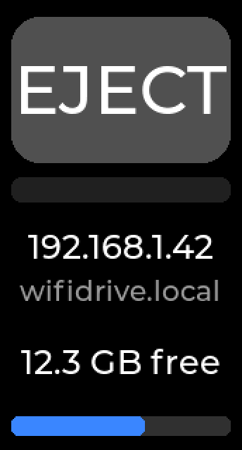
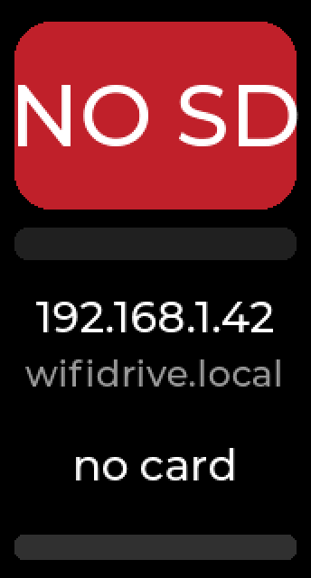
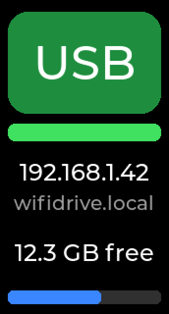
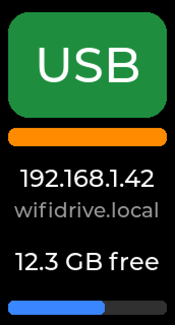
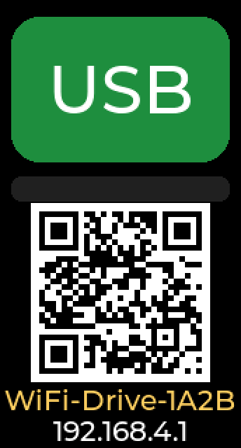

# WiFi Drive

Firmware that turns a [Waveshare ESP32-S3-LCD-1.47](https://www.waveshare.com/wiki/ESP32-S3-LCD-1.47)
into a USB stick you can also fill over WiFi.

Plug it into a PC or a 3D printer and it is an ordinary USB mass-storage device backed by
the microSD card. Open its web page from any browser on the same network and you can
upload, download and delete files. The firmware borrows the card from the USB host for
the duration of each WiFi operation and hands it back afterwards, so the host never sees
a half-written file system.

- Works as a plain FAT32 USB stick: no driver, no software on the host.
- Web page with file list, drag-and-drop upload, download, delete and settings.
- Automatic hand-over between the USB host and the WiFi side, with a status screen,
  colour LED and an "edit mode" that keeps the card on the WiFi side.
- WiFi setup without a PC: the drive opens its own setup network with a QR code on the
  screen and a captive portal.
- Firmware updates over WiFi with automatic rollback.
- Two printable enclosures.

<p align="center"></p>

The screen in each of its states. These are renders from the firmware's own layout and
bitmap fonts rather than photographs (`docs/render-screens.py` makes them); the panel
shows exactly this, except that the QR code in the renders is a placeholder pattern that
does not scan. The drive itself shows a real join code.

Engineering history, design notes and every test result are in [PLAN.md](PLAN.md).

## Contents

- [How it works](#how-it-works)
- [Hardware](#hardware)
- [Installation](#installation)
- [Using the drive](#using-the-drive)
- [Giving it your WiFi name and password](#giving-it-your-wifi-name-and-password)
- [HTTP API](#http-api)
- [Tools](#tools)
- [Troubleshooting](#troubleshooting)
- [Project layout](#project-layout)
- [Numbers to expect](#numbers-to-expect)
- [Credits and licences](#credits-and-licences)

## How it works

The SD card has one owner at a time. By default that is the USB host. When a WiFi
operation starts, the firmware waits until the host has been idle for 1.5 s, takes the
card (the host sees "no media"), does the transfer, and 5 s after the last WiFi
operation gives the card back. With the default "hard handoff" the USB device
re-enumerates on hand-back, so the host mounts the volume fresh and shows the new files
within about 10 s. If the host is busy, a WiFi operation waits up to 15 s and then
fails with "busy on the USB side" rather than interrupting a copy. The design and its
alternatives are discussed in PLAN.md, section 3.

## Hardware

- **Waveshare ESP32-S3-LCD-1.47**: ESP32-S3R8 (8 MB PSRAM), 16 MB flash, 1.47" 172x320
  LCD, microSD slot, USB-A plug, WS2812 LED, BOOT button. No soldering needed.
- **microSD card**, FAT32. Cards up to 32 GB format as FAT32 in Windows; bigger cards
  need a third-party formatter. The card must be in the slot at power-up.
- Optional: the board wires the SD card for 4-bit mode but leaves two 0 ohm jumpers
  (R11, R18) unpopulated, so the firmware runs 1-bit. Bridging them enables 4-bit;
  see PLAN.md, section 9. Not required.
- Optional: a printed enclosure. `enclosure/` is a two-part shell, `enclosure-minimal/`
  a one-piece tray; both have STL/3MF/STEP exports and their own README. The vendor
  STEP model they were designed around is not in this repository; the READMEs say where
  to download it.

## Installation

### Prerequisites

- **ESP-IDF v5.5** (developed and tested with v5.5.6). On Windows the easiest route is
  the Espressif Installation Manager (EIM); on Linux and macOS follow Espressif's
  "Get Started" guide. Either way you get a script that activates the environment.
- **Git** and **Python 3**. The scripts in `tools/` use only the standard library.
- Nothing else: the board plugs straight into a USB port.

### 1. Get the code

```bash
git clone https://github.com/devkriter/wifi-usb-drive.git
```

Everything below happens in `wifi-usb-drive/c-wifi-drive`, with the ESP-IDF environment
active (PowerShell with EIM: `. C:\Espressif\tools\Microsoft.v5.5.6.PowerShell_profile.ps1`;
Linux/macOS: `. ~/esp/v5.5.6/esp-idf/export.sh`).

### 2. Configure

The board settings live in `sdkconfig.defaults` and are right for the ESP32-S3-LCD-1.47
as sold.

You can bake your home WiFi credentials into the build, or leave them out and enter
them later through the setup network (see
[Giving it your WiFi name and password](#giving-it-your-wifi-name-and-password)).
To bake them in, create `c-wifi-drive/sdkconfig.secrets` (git ignores it):

```
CONFIG_ESP_WIFI_ROUTE_SSID="MyNetwork"
CONFIG_ESP_WIFI_ROUTE_PASSWORD="my-password"
```

Then generate the configuration:

```bash
idf.py -DSDKCONFIG_DEFAULTS="sdkconfig.defaults;sdkconfig.secrets" set-target esp32s3
```

or, without the secrets file, just `idf.py set-target esp32s3`. Credentials saved from
the web page later are stored in flash and take precedence over the baked-in ones.

Other options are under `idf.py menuconfig` → **WiFi Drive**:

| Menu | Option | Default | Meaning |
|---|---|---|---|
| Board | `WD_SD_4BIT` | off | 4-bit SD; only after bridging R11/R18 |
| Board | `WD_LCD_ROTATE_180` | off | flip the screen; the default puts the USB plug at the bottom |
| Board | `WD_LCD_BRIGHTNESS` | 80 | backlight, percent |
| Ownership handoff | `WD_USB_IDLE_MS` | 1500 | how long the host must be idle before a WiFi operation takes the card |
| Ownership handoff | `WD_RELEASE_MS` | 5000 | delay after the last WiFi operation before the card goes back |
| Ownership handoff | `WD_BORROW_TIMEOUT_MS` | 15000 | how long a WiFi operation waits for the host before giving up |
| Ownership handoff | `WD_HARD_HANDOFF` | on | re-enumerate USB after a hand-back |
| Ownership handoff | `WD_FALLBACK_AP_PASSWORD` | `wifidrive` | password of the setup network (8+ characters) |
| Ownership handoff | `WD_MDNS_HOSTNAME` | `wifidrive` | the drive answers as `<name>.local` |
| File server | `HTTP_UPLOAD_MAX_FILE_SIZE_MB` | | upload size limit |

### 3. Build

```bash
idf.py build
```

The result is `build/wifi_drive.bin`.

### 4. First flash over USB

The board has no separate programming port; its USB plug is both the drive and the
flashing interface.

1. Unplug the board. Hold **BOOT**, plug it in, release after a second. The chip is now
   in the ROM's download mode and shows up as a serial port (USB JTAG/serial).
2. Flash it, using that port's name:

   ```bash
   idf.py -p COM7 flash
   ```

   The project sets `CONFIG_ESPTOOLPY_BEFORE_NORESET`, so esptool does not try to reset
   the board first.
3. Unplug and plug it in again. When download mode was entered with the button the chip
   stays there after flashing, so it needs a power cycle to start the firmware.

On Windows, `tools/flash-and-log.ps1` does the flash and then opens the log.

The flash layout (`partitions.csv`) has two 3 MB OTA slots and no factory app;
`idf.py flash` writes the first slot.

### 5. Updates over WiFi

Once the firmware runs you never need the button again:

```bash
python tools/ota.py --url http://wifidrive.local --bin c-wifi-drive/build/wifi_drive.bin
```

The board reboots into the new image. If it does not come up healthy within 20 s the
bootloader rolls back to the previous one.

### 6. First-time WiFi setup

If you did not bake credentials in, the drive starts its own network. Follow
[Giving it your WiFi name and password](#giving-it-your-wifi-name-and-password).

## Using the drive

### Plugging in

- Hold it with the USB plug at the bottom; the screen is laid out that way.
- Within a few seconds Windows shows a "WiFi Drive" device with the card as a drive
  letter, plus a COM port ("WiFi Drive log"). The COM port only carries the firmware's
  log at 115200 baud; you can ignore it.
- The screen shows a green **USB** block once the PC has the card.
- Without a card the screen shows red **NO SD** and the drive never appears; WiFi and
  the web page still work.

### The screen

<p>






</p>

Top block, one word, colour-coded (same colours as the LED):

| Block | Meaning |
|---|---|
| **USB** green | The PC owns the card. Normal state. |
| **WIFI** blue | A WiFi file operation has borrowed the card. The PC sees "no media" until it is handed back. |
| **EDIT** blue | Edit mode: the card stays on the WiFi side until you leave edit mode. |
| **WAIT** amber | A WiFi operation is waiting for the PC to stop using the drive (up to 15 s, then it gives up). |
| **EJECT** grey | The PC did "Safely Remove". WiFi can use the card freely; the drive returns on the next hand-back. |
| **NO SD** red | No card answered at power-up. |

Strip under the block: flashes **green** when the PC reads, **orange** when the PC
writes, solid **blue** while the WiFi side owns the card, dark when idle.

<p>


</p>

Below: the IP address (or "no network"), the mDNS name `wifidrive.local`, free space,
and a usage bar.

While the setup network is up the lower half shows a join QR code instead, with the
setup network's name in yellow and the address `192.168.4.1` under it:

<p></p>

LED: dim green while the PC owns the card with bright green flashes on activity, blue
while the WiFi side owns it (brighter in edit mode), amber while waiting, blinking red
without a card.

### The web page

Open http://wifidrive.local/ or the IP shown on the screen.

- **Status bar**: who owns the card, free space, IP and WiFi signal, and the
  **Edit mode** button. It refreshes every 2 s.
- **File list**: click a name to download, **Delete** to remove, folders open in place,
  ".." goes up. The list comes from a cache taken the last time the WiFi side had the
  card, so browsing never disturbs the PC. **Refresh** rescans the folder and recounts
  free space (it borrows the card for a moment).
- **Upload**: drag a file onto the page or click the box, check the path and name,
  press Upload. The page returns to the folder when done.
- **Settings**:
  - *Hand back after N s*: how long after the last WiFi operation the card goes back to
    the PC (default 5 s).
  - *Hard handoff* (default on): the USB device re-enumerates after each hand-back, so
    the PC mounts the drive fresh and sees the new files within about 10 s. Off means a
    quieter media-change signal only; Windows then takes about 20 s to notice.
  - *Setup network*: start or stop the drive's own `WiFi-Drive-XXXX` network by hand
    (the screen shows the join QR code while it is up).
  - *WiFi*: the network to join (station), the drive's own network (access point) or
    both, with names and passwords. Submit saves them and restarts the board.

### What a WiFi transfer looks like from the PC

1. You start an upload. The firmware waits until the PC has been quiet for 1.5 s, then
   takes the card: the drive shows "no media" on the PC and the screen says **WIFI**.
2. The file is written. Downloads and deletes work the same way.
3. 5 s after the last WiFi operation the card goes back; with hard handoff the device
   re-enumerates and the drive reappears with the new contents.

If the PC is busy copying when a WiFi operation starts, the screen shows **WAIT**; after
15 s the operation fails with "busy on the USB side" and the PC copy continues
untouched. Retry later, or use edit mode.

Don't copy to or from the drive on the PC while a WiFi transfer is in progress, and don't
pull the plug during a WiFi upload.

### Edit mode

For many uploads in a row: press **BOOT** briefly or click **Edit mode**. The card stays
on the WiFi side (screen **EDIT**) and the PC cannot see the drive until you press the
button again or click **Leave edit mode**.

### Buttons

- **BOOT, short press**: toggle edit mode.
- **BOOT, hold 3 s**: restart into the ROM's download mode for flashing with esptool
  (recovery only; if Windows fails to see it, unplug and replug).

## Giving it your WiFi name and password

The drive joins one 2.4 GHz network (the ESP32-S3 has no 5 GHz radio). Three ways to
tell it which:

1. **Settings page, while it is already on a network.** Open Settings, choose *STA*
   under WiFi, type the new name and password, press Submit. The drive saves them and
   restarts; within about 15 s the screen shows its new IP address.
2. **Setup network, when it is on no network.** If the drive has no saved network, or
   cannot join the saved one after about half a minute of retries, it opens its own
   network **WiFi-Drive-XXXX** (XXXX comes from its MAC address; the exact name is on
   the screen and on the Settings page) with the password **wifidrive**, and shows a
   QR code. Scan the code with a phone camera to join (or pick the network by hand).
   The phone or laptop then shows its "Sign in to network" pop-up with the drive's
   Settings page in it, so there is nothing to type; use Settings as in 1. If no pop-up
   appears, open http://192.168.4.1/settings.html yourself; on the setup network any
   web address you type lands on that page, while http://192.168.4.1/ still shows the
   file list. The setup network has no internet, so the phone may ask whether to stay
   connected: say yes. The setup network stays up until the drive restarts, and the
   drive keeps retrying your network every 30 s meanwhile. USB keeps working throughout.
3. **Command line:**

   ```bash
   python tools/set-wifi.py --url http://192.168.4.1 --ssid "MyNetwork" --password "my-password"
   ```

   Use `--url http://wifidrive.local` when it is already on your network, or
   `--from-secrets secrets.yaml` to read `wifi_ssid` / `wifi_password` from an
   ESPHome-style secrets file. The script waits for the drive to come back.

To bring the setup network up by hand, for example to check the QR code or to connect
a phone, use *Setup network → Start* on the Settings page, or:

```bash
curl -X POST "http://wifidrive.local/api/wifi?ap=1"
```

(`ap=0` stops it.) The drive stays on your network while its setup network is up.
The setup network's password is a build setting (`WD_FALLBACK_AP_PASSWORD`); the QR
code always encodes the current one.

**AP, STA and AP+STA.** *STA* means the drive joins your network as a client. *AP*
means it runs a permanent network of its own with the name and password you give, on
which it is always 192.168.4.1. *AP+STA* does both at once. The single radio puts the
drive's own network on the same channel as yours, and the two share airtime. When an
AP is configured, the setup network is not started: your AP already offers a way in.
An empty AP password makes an open network; use at least 8 characters.

## HTTP API

Everything the web page does goes through these endpoints, so scripts can use them too.

| Method | Path | What it does |
|---|---|---|
| GET | `/` or `/folder/` | File list (HTML). `?refresh=1` rescans the folder and recounts free space. |
| GET | `/folder/file` | Download a file. |
| POST | `/upload/folder/file` | Upload; the request body is the file. |
| POST | `/delete/folder/file` | Delete a file. |
| GET, POST | `/settings.html` | Settings page. POST with form fields `wifimode` (`sta`, `ap`, `apsta`), `stassid`, `stapassword`, `apssid`, `appassword` saves the WiFi settings and restarts. |
| GET | `/api/status` | JSON: owner, edit mode, ejected flag, card size and free space, IP, RSSI, network names, USB read/write counters, borrow/hand-back counters, free heap, running partition, OTA state, build. |
| GET | `/api/events` | JSON: the last 48 firmware events (boots, borrows, hand-backs, uploads, deletes, ejects, button and web actions, OTA). |
| POST | `/api/wifi?ap=1` / `?ap=0` | Start or stop the setup network. |
| POST | `/api/owner?mode=app` / `auto` / `usb` | Enter edit mode, leave it, or hand the card back now. |
| POST | `/api/settings?release_s=N&hard=0\|1` | Hand-back delay and hard handoff. |
| POST | `/ota` | Firmware update; the request body is the `.bin`. |
| GET | `/api/reboot` | Restart. |
| GET | `/api/bootloader` | Restart into download mode. |
| GET | `/reset_msc` | Force a USB re-enumeration. |

Example upload from a shell:

```bash
curl -X POST --data-binary @part.gcode "http://wifidrive.local/upload/part.gcode"
```

Returns 503 if the USB host would not let go of the card within 15 s.

## Tools

All in `tools/`. The Python ones need only Python 3; the PowerShell ones are for Windows.

| Tool | What it does |
|---|---|
| `ota.py` | Send a firmware binary and wait for the drive to come back. |
| `set-wifi.py` | Set the WiFi name and password from the command line. |
| `wifi-upload-test.py` | Upload/download throughput test with a hash check. |
| `soak.py` | Long-running upload/verify/delete loop with USB activity in between. |
| `find-board-ip.ps1` | Find the drive on the LAN by its MAC address. |
| `flash-and-log.ps1` | Flash over USB and open the log. |
| `usb-speed-test.ps1` | USB read/write throughput on the mounted drive. |
| `watch-handoff.ps1` | Watch the drive letter appear and disappear during hand-overs. |

## Troubleshooting

- **The drive does not appear on the PC.** The card must be FAT32 and in the slot at
  power-up; the screen says **NO SD** otherwise. Replug after inserting a card.
- **"busy on the USB side" (HTTP 503).** The PC was using the drive for the whole
  15 s wait. Try again when the copy is done, or switch on edit mode first.
- **Windows takes 20 s to show new files.** Hard handoff is off; switch it on in
  Settings.
- **The setup network is not listed on a laptop.** It is 2.4 GHz only, and Windows only
  lists what its last scan saw; make sure WiFi is switched on and rescan.
- **The phone shows no sign-in pop-up.** Open http://192.168.4.1/settings.html by hand.
- **Flashing fails or the port is missing.** Enter download mode with BOOT held while
  plugging in, and use that port. After flashing, unplug and replug.
- **The board stays in download mode after flashing.** Expected when download mode was
  entered with the button; power-cycle it.
- **Log.** The "WiFi Drive log" COM port shows the live log at 115200 baud, and
  `/api/events` keeps the last 48 events across the web page.

## Project layout

| Path | What |
|---|---|
| `c-wifi-drive/` | The firmware. `main/` has the ownership state machine (`owner.c`), storage and USB (`storage.c`), the HTTP server and API (`app_http_server.c`, `api.c`), WiFi with the setup network and captive portal (`app_wifi.c`, `captive_portal.c`), the screen (`ui.c`), the cached listing, the event log and the CDC log mirror. `web/` holds the pages, embedded in the binary. |
| `tools/` | The scripts above. |
| `docs/` | The screen renders used in this README and `render-screens.py`, which draws them from `ui.c`'s layout and LVGL's Montserrat bitmap fonts (run it after `idf.py reconfigure` has fetched the LVGL sources). |
| `enclosure/`, `enclosure-minimal/` | Printable enclosures with exports, renders and their own README. |
| `a-usb-stick/` | Espressif's TinyUSB MSC example as the first milestone (plain USB stick), kept for reference. |
| `b-wireless-disk/` | Espressif's wireless-disk example as the second milestone, kept for reference. The HTTP server and web pages of the firmware started from it. |
| `PLAN.md` | The plan, the design discussion and the dated progress log with all measurements. |

The project was built by leaning on Espressif's published examples at each step rather
than writing from scratch; PLAN.md records what was taken from where and what had to
change.

## Numbers to expect

- USB: about 0.9 MB/s write, 0.65 MB/s read (full-speed USB is the limit).
- WiFi: about 1.2 to 1.5 MB/s up, 1 MB/s down on 1-bit SD.
- Over-the-air update: about 25 s for a 2 MB image.
- The web page handles one request at a time: during an upload the status bar pauses
  until the upload finishes.

## Credits and licences

- `a-usb-stick/` is Espressif's `tusb_msc` example from ESP-IDF, and `b-wireless-disk/`
  is the `usb_msc_wireless_disk` example from esp-iot-solution; the HTTP server and web
  pages in `c-wifi-drive/` are derived from the latter and the captive portal from
  ESP-IDF's `captive_portal` example. These are Apache-2.0 licensed by Espressif.
- The firmware uses ESP-IDF, esp_tinyusb and the mdns and led_strip components
  (Apache-2.0) and LVGL (MIT).
- Board documentation and the reference STEP model are from the Waveshare wiki.
- Everything else in this repository (firmware, tools, documentation and the enclosure
  designs) is released under the Apache License 2.0; see [LICENSE](LICENSE) and
  [NOTICE](NOTICE). Copyright 2026 devkriter.
